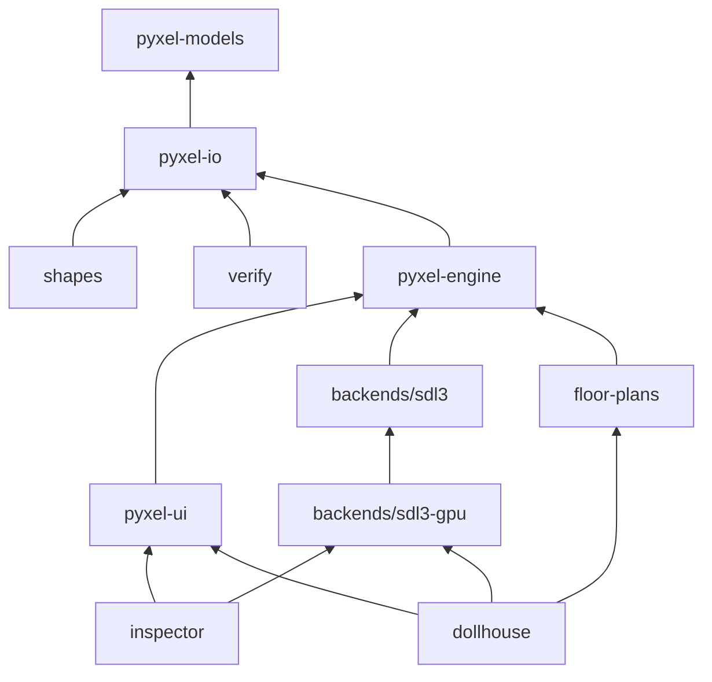

# Dollhouse

The libraries fall into two kinds:

- **Pure libraries** know no window system and no GPU API. They hold the logic and the data, and are tested with a fake backend, so they count towards the coverage.
- **Backends** under `libs/backends/` are the concrete SDL3 code: thin, and the only places where SDL is called.

The reasons behind this split, the libraries considered and the event flow are in [ui-framework-analysis.md](ui-framework-analysis.md).

## Pyxel models

- uses `pyxel` namespace
- contains 3D graphics math
  - based on glm
  - uses strong typedefs for angles, lengths, offsets and sizes, inspired by std::chrono
- allows watching file changes to notify the upper layers to refresh their logic
- defines 3D objects, some anonymous, some named; named object may have event handling (mostly: activate). Think light switches, doors opening/closing.
- defines materials: paints, textures, allows wrapping a texture on a group
- defines directional, spot and point lights

## Pyxel I/O

- uses `pyxel::io` namespace
- depends on `pyxel-models`
- uses assimp to load/store objects
- reads and writes what Assimp cannot: area lights and the interactions of active objects, in glTF 2 (`glb2-pyxel`, `gltf2-pyxel`)

## Pyxel engine

- uses `pyxel` and `pyxel::app` namespaces
- depends on `pyxel-io`
- knows no window system, no GPU API and no ImGui
- defines the application lifecycle (`setup`, `update(dt)`, `draw`, `shutdown`), with the backends picked by the application
- defines its own events and key codes; the backends translate theirs into these
- defines the input binding engine: buttons, wheels and sticks from the keyboard, mouse and gamepads, mapped to commands; gameplay bindings use scancodes, shortcuts use keycodes
- defines the window and platform interfaces, and the window state kept between runs (position, size, maximized, monitor)
- defines cameras (free-flying or player-bound)
- enables object collisions to enable the player-bound movement
- describes what is drawn, as data with no GPU calls: the scene with its meshes, materials, lights, textures and sky boxes, and the order of the passes

## Pyxel UI

- uses `pyxel::ui` namespace
- depends on `pyxel-engine` and Dear ImGui (docking branch)
- owns the ImGui context, feeds ImGui from engine events (not through `imgui_impl_sdl3`), sets up docking and the font (ProggyForever, embedded in ImGui)
- hands over ImGui's draw data each frame without drawing it, so it runs headless in the tests
- does not wrap the widgets; panels call ImGui directly
- ImGui stays out of the public headers of the engine

## SDL3 backend

- uses `pyxel::sdl3` namespace
- lives in `libs/backends/sdl3`
- depends on `pyxel-engine` and SDL3
- implements the window and platform interfaces: creates the window, drains the SDL event queue and translates it into engine events (keys, mouse, text, gamepad hotplug, buttons and axes), reads and applies the window state
- knows nothing about the GPU; owns no camera, HUD or font

## SDL3 GPU backend

- uses `pyxel::sdl3::gpu` namespace
- lives in `libs/backends/sdl3-gpu`
- depends on `backends/sdl3`, and on Dear ImGui for `imgui_impl_sdlgpu3`
- the only library calling the SDL GPU API
- creates the device, Vulkan first, falling back to the platform's native driver (D3D12, Metal), and claims the window for it
- shaders are written once as SPIR-V; SDL_shadercross turns them into DXIL or MSL for the fallback drivers
- owns the shaders, buffers, textures and pipelines, and runs the passes the engine describes: the scene, the overlay, and the UI (the draw data of `pyxel-ui`)
- its caches are objects created by the application and passed down, not singletons

## SDL3 + ImGui glue (temporary)

- uses `pyxel::sdl3` namespace
- lives in `libs/backends/sdl3-imgui`
- depends on `backends/sdl3-gpu` and `pyxel-ui`
- feeds ImGui from SDL's own events through `imgui_impl_sdl3`, until the engine events carry the keyboard, mouse, text and gamepads and `pyxel-ui` is fed from them
- puts the platform, the window, the device, the renderer, the ImGui context and the ImGui pass together in the right order of destruction (`imgui_gpu_stack`), as the stack the applications pick

## Shapes (python package)

- uses `shapes` namespace
- depends on `pyxel-io`
- a Python 3 package exposing `pyxel-models`
- is a tool (has a `__main__`), so it can be used directly
- batch and single mode, plus `--watch` mode

## Verify (tool)

- depends on `pyxel-io`
- reads a `.glb` or `.gltf` file and prints its bounding box and active objects, and emulates their actions

## Floor plans

- uses `plans` namespace
- depends on `pyxel-engine`
- main responsibility is to define the YAML parser and putting the whole scene together

## Inspector (app)

- depends on `pyxel-ui` and `backends/sdl3-gpu`
- views and tests a single model
- a tool UI: most panels (log, sun, states, actions, inputs, outputs) are docked around the 3D view, and the dock layout is kept with the window state

## Dollhouse (app)

- uses `house` namespace
- depends on `floor-plans`, `pyxel-ui` and `backends/sdl3-gpu`
- selects the backends for engine
- runs the application
- keeps the house in front: a minimal set of floating windows and widgets over the 3D view

## Rules

- The window is only a window. Cameras, HUD, messages and fonts live in the application or the renderer.
- No singletons; services are created in `main` or by the application and passed by reference.
- No string-addressed widgets; panel code reads the application state directly.
- A header of a lower layer never includes a higher one.
- Every SDL and ImGui pointer is owned by a `std::unique_ptr` whose deleter is an empty type, so the handle is the size of the pointer. GPU resources, released through their device, are the one exception (see [Handles](ui-framework-analysis.md#handles)).
