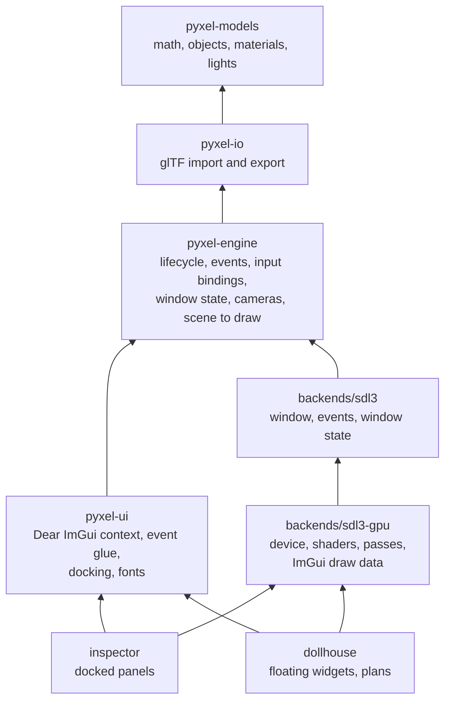

# UI framework analysis

How to build the application framework and the UI of Inspector and Dollhouse (stages 1, 2 and 4 of the [roadmap](roadmap.md)), so that most of it does not depend on the window system, and what to take from the planner and from Cinder.

## What the UI has to do

From the roadmap, the UI is mostly tool UI, plus a little in-world overlay:

| Need | Stage | Kind |
| --- | --- | --- |
| Log view (warnings, errors), controls for the sun | 1 | tool panels |
| Controls for states, actions and inputs, view of outputs | 2 | tool panels |
| Errors and warnings of the project in the log view | 4 | tool panels |
| Crosshair, picked object highlight | 2, 4 | in-world overlay |
| Wires overlay, camera frustums | 7 | in-world overlay |
| Input bindings for buttons, wheels and sticks, mouse and keyboard, later Xbox and PlayStation controllers | 1, 7 | input |
| Window position, size and state kept between runs | 1 | platform |

The roadmap also asks for a UI engine "independent of the backend window implementation", and for Dollhouse to reuse the Inspector framework.

## Lessons from the planner

The planner (`e:\code\planner`, about 25k lines of C++) already has an engine, a GLFW backend and a retained-mode UI. The UI itself is small (about 2.3k lines); the stuffiness comes from where things live, not from how much there is:

- **The window is a god object.** `pyxel::window` (`libs/engine/include/pyxel/backend/window.hpp`) is the platform window, but also the camera controller (`move_to`, `move_to_player_eyesight`), the HUD owner (`add_widget`, `find_widget`, `set_font`), the message bar (`set_message`) and the workload tracker. `glfw::window` builds the whole HUD (position, FPS, FOV and message panels) inside the backend, so the backend cannot be replaced without rewriting the HUD.
- **One interface for the OS and the GPU.** `pyxel::system` (`backend/system.hpp`) mixes monitors and window creation with buffers, shaders and textures, and exposes SDL pixel formats in its default methods.
- **Singletons.** `system::get()`, `shader_manager::instance()`, `textures::instance()`, `gamepad_handler::instance()` and others make the order of creation implicit and the code hard to test without a window.
- **The application owns the scene.** `base_application` holds the main loop and also lights, sky box and cameras.
- **The UI is display-only and addressed by string ids.** Widgets get no events; the application pushes data with `find_widget("id")->set_text()` and string-keyed updaters. There are also two widget systems side by side (`ui/widget.hpp` and `ui/widgets.hpp`).
- **Headers are tangled.** `backend/window.hpp` includes `ui/widget.hpp`, the renderer includes the window, the UI includes the system.

What is good and worth carrying over:

- **Input bindings.** `hid_handler` with its mapping DSL (`keycode::F5 >> cmd::reload`, `left_joystick{} >> cmd::move_camera`) and command listeners is independent of the backend; only `glfw_input.cpp` translates GLFW codes. It is close to the "input binding engine" of stage 1.
- **`window::client`**, the small callback struct for moves, file drops, refreshes and scale changes.
- **`event_pump`**, the per-thread queue of tasks.
- **The `Drawable` concept** of the renderer, and `base/` and `math/`.
- **The GL boundary.** No `gl*` call appears outside the backend (one include in `tiles_material.cpp` aside).

## What Cinder shows

Cinder (BSD 2-clause, last commits in 2024, C++17) is a whole framework with vendored dependencies (GLFW, glad, ImGui, freetype, zlib, asio and more), no Conan package and no installable CMake package. It is not worth taking as a dependency, but a few of its ideas fit well:

- **Lifecycle in a base class, platform chosen at build time.** `AppBase` declares `setup`, `update`, `draw` and the event handlers; `CINDER_APP(App, Renderer)` expands to the `main` of the platform. The platform split itself is done with `#ifdef` inside public headers (`Window.h`, `Renderer.h`), which is the part not to copy.
- **Own event types and key codes.** `MouseEvent`, `KeyEvent` and Cinder key codes hide the backend; GLFW codes are translated on the way in.
- **Prioritized signals that can stop an event.** Each window emits signals (`include/cinder/Signals.h`); a slot can mark an event handled and the later slots do not see it. This is how its ImGui integration takes the mouse before the application does.
- **ImGui driven by the framework's events, not by GLFW.** `CinderImGui.cpp` feeds ImGui from Cinder's own window signals and draws with `imgui_impl_opengl3`, so the UI does not care which window system is below.
- **A headless backend** chosen by a build option.

Cinder has no gamepad support, and on Windows it uses Win32 directly, not GLFW, so its Linux files (`src/cinder/app/linux/*Glfw*`) are the only example of wrapping GLFW.

## Options

### Window system

| | GLFW 3.4 | SDL3 |
| --- | --- | --- |
| Windows, Linux (X11, Wayland) | yes | yes |
| OpenGL context | yes | yes (and its own GPU API) |
| Window position, size, maximized | yes | yes, with events for moves, resizes, maximizing and display changes |
| Input delivery | callbacks per kind of input | one event queue (`SDL_PollEvent`), a tagged union per event |
| Gamepads | polled state, with the SDL controller database; name only | events for hotplug, buttons and axes, and polled state; `SDL_GetGamepadType` and `SDL_GetGamepadButtonLabel` tell Xbox from PlayStation; rumble |
| Text input | characters only | text and IME events, which ImGui text fields need |
| Image loading | none | `SDL_image`, already used by the planner |
| Conan | `glfw/3.4` | `sdl/3.4.16` (see [Dependencies](#dependencies)) |
| Known from the planner | yes | image loading only (`sdl_image`) |

**Decided: SDL3.** Dollhouse is the moment to take it: `libs/backends/glfw` is still empty, so nothing is lost but familiarity.

- **It fits the planner's input design.** A single event queue maps onto engine events with one `switch`, the job `glfw_input.cpp` does in the planner across several callbacks. The binding DSL and the command listeners stay as they are; only the translation is new.
- **It covers stage 7 for free.** "Detect the type, map Xbox A to PlayStation Cross" is one call in SDL3, and has no answer in GLFW beyond the controller name.
- **It covers the window state of stage 1** with events and getters for position, size, flags and display.

One thing to decide in the engine from the start, whichever backend is used: gameplay bindings use scancodes (physical keys, so WASD stays WASD on AZERTY) and shortcuts use keycodes (the letter on the key).

### Rendering

**Decided: the SDL3 GPU API, with platform's available drivers used.** OpenGL is not used.

- **Device.** `SDL_CreateGPUDevice` is asked for `"vulkan"` first. When that fails, it is called again with no driver name and SDL picks the native one (D3D12 on Windows, Metal on macOS). The chosen driver goes to the log.
- **Shaders are written once, as GLSL, but cross-transpiled.** Build process produces shadres compatible with Vulkan (SPIR-V) and D3D12 (DXIL). At the moment, the transpiler is SDL_shadercross, but this may change. The Metal backend (MSL) isnot supported at the moment, as `./flow` was not yet configured to build MacOS binaries. The planner's GLSL shaders (`data/shaders/*.vert`, `*.frag`) are not reused, a fresh pipeline is prepared.
- **ImGui needs no shadercross.** `imgui_impl_sdlgpu3` carries its own shaders, precompiled for SPIR-V, DXBC and Metal, and picks one from the formats the device supports.

### UI

| | Dear ImGui | Own retained UI (planner style) | RmlUi (HTML/CSS) |
| --- | --- | --- | --- |
| Fit for tool panels | very good: log, sliders, trees, tables | needs every widget written | good, but heavy for panels |
| Input handling | built in, with keyboard and gamepad navigation | none yet in the planner | built in |
| Code to own | a thin glue layer | everything | glue plus documents and styles |
| Backend independence | yes, if fed from our own events | yes | yes |
| Conan | `imgui` | n/a | `rmlui` |

Tool panels are what stages 1 and 2 need, and they are what Dear ImGui is made for. Immediate mode also removes the main source of the planner's mess: there is no widget tree to own, no string ids and no updaters, as the panel code reads the state directly every frame.

**Decided: Dear ImGui, docking branch, with a different layout per application.**

- **Inspector** is a tool and looks like one: most panels (log, sun, states, actions, inputs, outputs) are docked around the 3D view, and the dock layout is kept between runs next to the window state.
- **Dollhouse** keeps the house in front: a minimal set of floating windows and widgets over the 3D view, with little or no docking.
- **Font**: ProggyForever for now. Dear ImGui embeds it (`AddFontDefaultVector()`), so nothing is shipped in `data/` yet; it scales, unlike the bitmap ProggyClean.

The in-world overlays (crosshair, highlight, wires, frustums) are not panels. They belong to the renderer, drawn as part of the scene or as a 2D pass, not in a widget toolkit.

## Dependencies

Checked on Conan Center in November 2026, against the current `conanfile.txt`:

| Package | Latest | License | Notes |
| --- | --- | --- | --- |
| `sdl` | 3.4.16 (3.2 line from 3.2.6) | Zlib | every subsystem is an option (`audio`, `video`, `gpu`, `render`, `camera`, `joystick`, `haptic`, `hidapi`, `power`, `sensor`, `dialog`, `tray`), and so are the Linux pieces (`alsa`, `pulseaudio`, `sndio`, `wayland`, `x11` and others) |
| `sdl_image` | 3.4.4 (2.8.12 for SDL2) | MIT | JPEG, PNG, TIFF, WebP and AVIF by default; AVIF alone brings dav1d, libaom and libyuv |
| `imgui` | 1.93.0, also `1.93.0-docking` | MIT | ships the official backends in `res/bindings`, `imgui_impl_sdlgpu3` included; `with_sdl3_binding` is off by default, which suits a glue fed from engine events |
| SDL_shadercross | not on Conan Center | Zlib | to be a git submodule under `external/`, built with the project against the Conan SDL3; it depends on SPIRV-Cross, and on DXC for DXIL |

Both graphs resolve together with the current requirements, with no version conflicts (zlib and libpng meet assimp's on one version):

- **Windows** (MSVC 19.4, C++23): most packages come as binaries; `sdl_image`, `assimp`, `gtest`, `mbits-args` and `minizip` build from source.
- **Linux** (GCC 14, C++23): resolves with SDL audio off, Wayland off and `sdl_image` reduced to JPEG and PNG, using the system X11 (`xorg/system`) and `libudev/system`; the build machines need the X11 development packages.
- **Wayland** needs `xkbcommon/1.6.0`, whose recipe requires Conan 2.18 or newer. Older Conan fails to load the graph; `sdl/*:wayland=False` avoids it until Wayland is needed.
- **Conan itself** has to stay close to its latest release, locally and in CI: Conan Center recipes move to newer Conan features, and an older client stops loading them, as with `xkbcommon` above. CI already does: `proj-flow-actions/setup-conan` runs `pip3 install conan --upgrade` (two actions deep), so the local client is the one to keep updated.

A starting point, with the options turned back on when a stage needs them (`haptic` for rumble in stage 7, more image formats for textures in stage 6). The `gpu` option of `sdl` stays on:

```ini
[requires]
sdl/3.4.16
sdl_image/3.4.4
imgui/1.93.0-docking

[options]
sdl/*:audio=False
sdl/*:camera=False
sdl/*:tray=False
sdl_image/*:with_avif=False
sdl_image/*:with_libtiff=False
sdl_image/*:with_libwebp=False
```

## Structure

The libraries and their dependencies are also listed in [project-structure.md](project-structure.md); this section gives the reasons.

The libraries fall into two kinds:

- **Pure libraries** know no window system and no GPU API. They hold the logic and the data, and are tested with a fake backend, so they count towards the coverage.
- **Backends** under `libs/backends/` are the concrete SDL3 code. They are thin, and the only places where SDL is called.

SDL GPU is not hidden behind an interface of our own. It is already the layer over Vulkan, D3D12 and Metal, and a second one would only repeat it (the point of [Layers All The Way Down](https://moonside.games/posts/layers-all-the-way-down/)). What stays independent of SDL is the data the renderer draws, not the renderer.



- **`pyxel-engine`** knows no window system, no GPU API and no ImGui. It holds the application lifecycle (`setup`, `update(dt)`, `draw`, `shutdown`), its own event types and key codes, the input binding engine (the planner's `hid_handler`, ported), the window state (position, size, maximized, monitor) and the abstract window and platform interfaces. It also describes what is drawn: cameras, the scene with its meshes, materials and lights, the `Drawable` concept and the order of the passes, as data with no GPU calls.
- **`pyxel-ui`** wraps Dear ImGui without SDL: the context, a platform glue fed from engine events (as Cinder does, instead of `imgui_impl_sdl3`), docking and the font. Each frame it hands over ImGui's draw data (`ImDrawData`) and does not draw it itself, so it runs headless in the tests. It does not wrap the widgets; panels call ImGui directly. ImGui stays out of the public headers of the engine.
- **`backends/sdl3`** (replacing the empty `backends/glfw`) implements the window interface: it creates the window, drains the SDL event queue and translates the events into engine events (keys, mouse, text, gamepad hotplug, buttons and axes), and reads and applies the window state. It knows nothing about the GPU, and owns no camera, HUD or font.
- **`backends/sdl3-gpu`** is the only library calling the SDL GPU API. It creates the device (Vulkan first, see [Rendering](#rendering)) and claims the window from `backends/sdl3` for it; it owns the shaders (in the variant matching the device's format), buffers, textures and pipelines, and runs the passes the engine describes: the scene, the overlay, and the UI pass, which draws `pyxel-ui`'s draw data through `imgui_impl_sdlgpu3`. Its services (shader and texture caches) are objects created by the application and passed down, not singletons.
- **The applications** (Inspector, Dollhouse) hold the panels, the dock layouts, the scene and the cameras, and pick the backends in `main`, the way `CINDER_APP` does.

The window does not know the device: the GPU backend takes the window, not the other way round. A tool that needs input but no rendering (the input tests of the backend) links `backends/sdl3` alone.

### Event flow

Every frame, the backend turns the raw input into engine events and hands them over in a fixed order:

1. **UI.** ImGui takes the event first. When it wants the mouse or the keyboard (`WantCaptureMouse`, `WantCaptureKeyboard`), the event stops here.
2. **Input bindings.** The remaining events and the gamepad state go through the bindings and turn into commands (`next_camera`, `reload`, `move_camera`).
3. **Application.** Command listeners and the lifecycle methods react.

This keeps the controllers in mind from the start: a gamepad drives the bindings, and also ImGui's navigation when a panel has focus.

### Handles

SDL and Dear ImGui hand out naked C pointers with a function to destroy each kind. The libraries never pass those pointers around bare; every owned one sits in a `std::unique_ptr` whose deleter calls the matching C function:

```cpp
template <auto Destroy>
struct c_deleter {
    template <typename T>
    void operator()(T* ptr) const noexcept { Destroy(ptr); }
};

template <typename T, auto Destroy>
using c_ptr = std::unique_ptr<T, c_deleter<Destroy>>;

using window_ptr = c_ptr<SDL_Window, SDL_DestroyWindow>;
using gpu_device_ptr = c_ptr<SDL_GPUDevice, SDL_DestroyGPUDevice>;
using gamepad_ptr = c_ptr<SDL_Gamepad, SDL_CloseGamepad>;
using sdl_string = c_ptr<char, SDL_free>;
using imgui_context_ptr = c_ptr<ImGuiContext, ImGui::DestroyContext>;

static_assert(sizeof(window_ptr) == sizeof(SDL_Window*));
```

**Zero overhead** means the deleter carries no state: the destroy function is a template argument, not a stored function pointer, so the deleter is an empty type and the `unique_ptr` is the size of the raw pointer. A `static_assert` next to each alias keeps it that way. `unique_ptr` never calls its deleter with null, which matters for `ImGui::DestroyContext`, where null means "the current context".

**The exception is the GPU resources.** Textures, buffers, transfer buffers, samplers, shaders, pipelines and fences are released through the device (`SDL_ReleaseGPUTexture(device, texture)`), and so is a window claimed by it (`SDL_ReleaseWindowFromGPUDevice`). A stateless deleter cannot know the device without a global, and globals are ruled out below. These handles store the device next to the pointer (two pointers instead of one), either in a small `gpu_ptr<T, Release>` or in the object that groups them (a mesh with its buffers, a material with its pipeline), which then releases them all in its destructor. The device has to outlive every one of them, which the owner of the renderer guarantees by order of destruction.

ImGui's backends (`imgui_impl_sdlgpu3`) have no handle at all: `Init` and `Shutdown` work on the current context. `pyxel-ui` pairs them in one RAII object, created after the ImGui context and destroyed before it.

### Rules that keep it from getting stuffy

- The window is only a window. Cameras, HUD, messages and fonts live in the application or the renderer.
- OS and GPU are separate libraries: `backends/sdl3` never calls the GPU API.
- Every SDL and ImGui pointer is owned by a handle (see [Handles](#handles)).
- No singletons; services are created in `main` or by the application and passed by reference.
- No string-addressed widgets; panel code reads the application state directly.
- A header of a lower layer never includes a higher one (engine never includes UI or GPU headers).

## Open questions

- **When shadercross runs**: at build time, with the DXIL and MSL variants shipped next to the SPIR-V, or at runtime, only when the device is not Vulkan. Build time keeps shadercross and DXC out of the packages; runtime keeps the build simpler. Either way it comes from the `external/` submodule (see [Dependencies](#dependencies)).
- **Shader source language**: GLSL or HLSL, compiled to SPIR-V by `glslang` or DXC.
- **Overlay text** (crosshair labels, wires overlay markers): ImGui's background draw list is enough at first; a renderer text pass only if needed.
